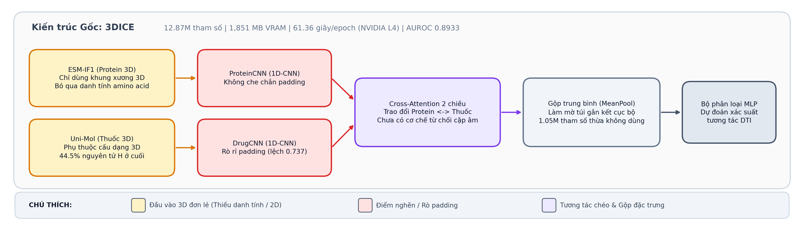
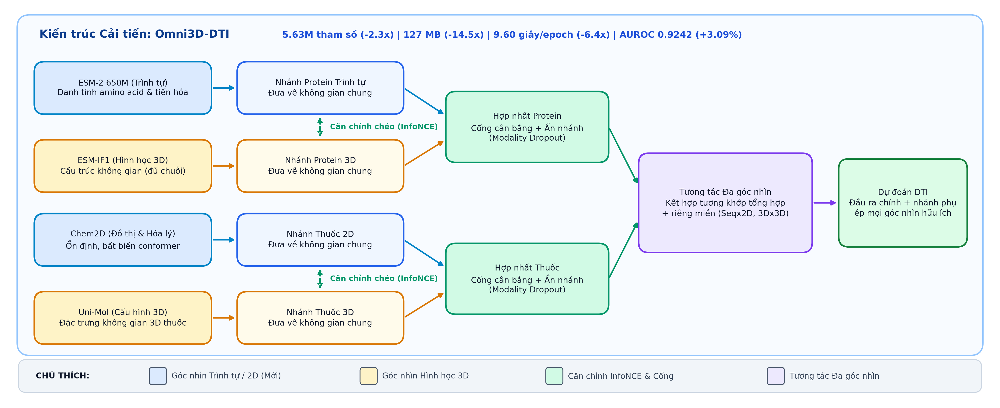
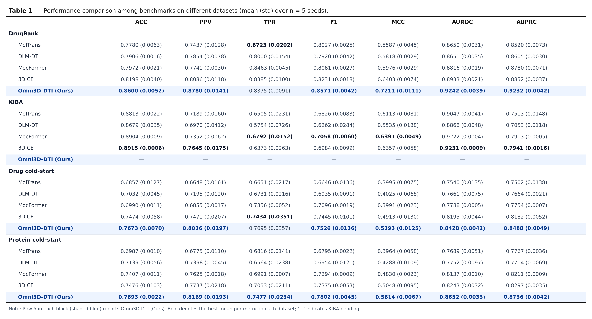

# Báo cáo Tiến độ 3DICE

## 1. Đánh giá Mã nguồn từ Bài báo Gốc

Chúng tôi đã kiểm tra mã nguồn GitHub chính thức của bài báo **3DICE** (Bioinformatics, 2026) và chạy tái hiện đối chứng trên cùng phần cứng GPU NVIDIA L4. Kết quả chạy lại khớp sát với số liệu công bố trên cả 3 bộ chia DrugBank (`db_std` AUROC `0.8940` so với `0.8933`; `drug_cs` `0.8118` so với `0.8195`; `prot_cs` `0.8181` so với `0.8243`), đồng thời làm rõ bốn vấn đề cốt lõi về mặt dữ liệu và kiến trúc:

**Phát hiện 1:** Đầu vào protein chỉ nhìn tọa độ khung xương 3D, bỏ qua hoàn toàn danh tính amino acid (`3DICE/protein/02_embed_protein_3D.py`, dòng 153–158). Mã nguồn đọc cả tọa độ `coords` và chuỗi trình tự `seq`, nhưng hàm sinh biểu diễn `ESM-IF1` lại bỏ qua biến `seq`. Hệ quả là mô hình không phân biệt được bản chất hóa học mạch nhánh giữa các amino acid có hình dạng khung xương gần nhau (ví dụ acid vs trung tính) và thiếu toàn bộ ngữ cảnh tiến hóa họ protein — đặc biệt bất lợi khi gặp protein hoàn toàn mới (`Protein Cold-start`).

**Phát hiện 2:** Cắt nhầm amino acid cuối chuỗi và rò rỉ nhiễu padding qua mạng tích chập (`3DICE/dataset.py`, dòng 194–197; `3DICE/model.py`, dòng 123–142). Mặc định của `dataset.py` tự động cắt bỏ token cuối của protein (`[:-1]`), làm mất 1 amino acid thật ở đầu C trong `94/95` mẫu kiểm tra. Bên cạnh đó, khối 1D-CNN không che chắn vùng đệm `padding`, khiến giá trị đầu ra của cùng một mẫu thay đổi sai lệch tới `0.737` khi đổi kích thước batch (`B=1` so với `B=32`). Về phía thuốc, `44.5%` token từ Uni-Mol là nguyên tử Hydro xếp ở cuối chuỗi, làm loãng tín hiệu dược lý.

**Phát hiện 3:** Lãng phí tài nguyên tính toán nhưng chủ yếu dựa vào tín hiệu tương thích thô (`3DICE/model.py`, dòng 343–397). Khối `FusionNew` khởi tạo tới `1.05M` tham số tuyến tính thừa không hề được gọi khi suy luận. Sau tương tác chéo, toàn bộ chuỗi bị nén bằng trung bình cộng đều (`Mean Pooling`), làm mờ vùng túi gắn kết cục bộ và khiến mô hình tốn tới `12.87M` tham số, `1,851 MB` VRAM và `61.36 giây/epoch`. Kiểm chứng đối chứng cho thấy một mạng rất nhẹ chỉ nhận vector trung bình thô đã giải thích được gần `89.2%` năng lực phân loại (`AUROC 0.8516` trên `db_std`) của cả mô hình `3DICE` cồng kềnh.

**Phát hiện 4:** Góc nhìn 3D đơn lẻ dễ bị nhiễu ở các kịch bản Cold-start. Khi gặp thuốc mới (`Drug Cold-start`), đặc trưng Uni-Mol phụ thuộc trực tiếp vào một cấu dạng không gian 3D (conformer) cụ thể nên dễ dao động theo biến thiên hình học; trong khi với protein mới (`Protein Cold-start`), việc thiếu thông tin tiến hóa trình tự khiến mô hình khó nhận diện các đích tương đồng về mặt sinh học.

---

## 2. Kiến trúc Mô hình Gốc (3DICE)

Mô hình `3DICE` gốc có tổng cộng `12.87M` tham số huấn luyện, tiêu tốn `1,851 MB` VRAM đỉnh và mất `61.36 giây/epoch` trên GPU NVIDIA L4 (`batch_size = 32`), gồm bốn thành phần chính:

1. **Đầu vào 3D đơn góc nhìn (Single-View 3D Inputs):** Trích xuất vector đóng băng theo từng điểm từ `ESM-IF1` cho khung xương 3D protein (bị cắt nhầm 1 residue cuối) và từ `Uni-Mol` cho toàn bộ nguyên tử của thuốc (kèm tỷ lệ lớn Hydro).
2. **Hai nhánh tích chập 1D (ProteinCNN & DrugCNN):** Áp dụng tích chập 1 chiều dọc theo chuỗi nhưng bỏ qua mặt nạ che padding, gây rò nhiễu giữa vùng dữ liệu thật và phần đệm trống.
3. **Tương tác chéo hai chiều (Bidirectional Cross-Attention):** Cho chuỗi protein và chuỗi nguyên tử thuốc trao đổi chú ý hai chiều với nhau, tuy nhiên softmax ép mọi vị trí đều phải gán trọng số chú ý ngay cả khi cặp phân tử không tương tác.
4. **Gộp trung bình và Bộ phân loại (MeanPool & MLP):** Nén toàn bộ chuỗi sau chú ý bằng trung bình cộng đều qua khối `FusionNew` (còn dư `1.05M` tham số không sử dụng) rồi đưa qua `MLP` để dự đoán xác suất tương tác.

---

## 3. Cải tiến Kiến trúc Omni3D-DTI

Trước khi lựa chọn thiết kế cuối cùng, chúng tôi đã kiểm chứng vì sao các hướng cải tiến đơn giản hơn chưa giải quyết được gốc rễ vấn đề: (i) chồng thêm tầng chú ý lên cùng đầu vào 3D cũ nhanh chóng chạm trần quanh mức `~0.89` AUROC do thiếu thông tin amino acid và cấu trúc hóa học 2D; (ii) bổ sung các đặc trưng đồ thị lân cận thủ công từ tập huấn luyện gây học vẹt cấu trúc và sụt mạnh xuống `0.768` AUROC khi kiểm thử, khẳng định mô hình bắt buộc phải thuần quy nạp (100% inductive); và (iii) ghép nối thô (concatenation) giữa đặc trưng mới và đặc trưng 3D cũ giúp tăng vọt hiệu năng trên cặp thuốc–đích quen, nhưng lại làm giảm nhẹ độ chính xác trên `Protein Cold-start` (`0.8424` so với `0.8471` khi bỏ 3D) vì nhiễu hình học từ protein chưa từng thấy lấn át tín hiệu trình tự.

Từ các quan sát đó, kiến trúc **Omni3D-DTI** (`5.63M` tham số — nhẹ hơn `2.3×`, dùng `127 MB` VRAM — ít hơn `14.5×`, và chạy `9.60 giây/epoch` — nhanh hơn `6.4×`) được xây dựng xoay quanh năm ý tưởng cốt lõi và tác động rõ rệt:

- **Bốn góc nhìn bổ trợ toàn diện (Trình tự + 2D + 3D):** Bổ sung `ESM-2 650M` để cung cấp danh tính amino acid cùng ngữ cảnh tiến hóa cho protein, kết hợp `Chem2D` (vân tay đồ thị phân tử và mô tả hóa lý bất biến theo conformer) cho thuốc, song hành cùng hai góc nhìn 3D sẵn có (`ESM-IF1` và `Uni-Mol`). Ý tưởng này vá đồng thời điểm mù sinh–hóa học ở protein mới và độ nhạy conformer ở thuốc mới.
- **Loại bỏ rò rỉ dữ liệu và tinh gọn bộ mã hóa:** Giữ nguyên vẹn toàn bộ chuỗi amino acid, chuẩn hóa thống kê riêng theo tập huấn luyện, thay thế khối CNN/Cross-Attention cồng kềnh bằng 4 nhánh mã hóa gọn nhẹ độc lập cùng chuẩn hóa sạch `1.05M` tham số thừa. Tác động là giảm tới `93.1%` lượng VRAM sử dụng và rút ngắn `6.4×` thời gian mỗi epoch.
- **Căn chỉnh chéo hai miền đặc trưng (Cross-View InfoNCE):** Đây là cầu nối quan trọng nhất giúp dữ liệu Trình tự/2D và dữ liệu 3D của cùng một phân tử học cách biểu diễn trên một không gian ngữ nghĩa chung (có khử trùng lặp thực thể trong cùng batch). Nhờ được "phiên dịch" về cùng ngôn ngữ, thông tin 3D không còn gây nhiễu mà bổ trợ tích cực cho trình tự ngay cả trên `Protein Cold-start`.
- **Hợp nhất cân bằng và cơ chế chống ỷ lại nhánh (Adaptive Gate + Modality Dropout + Giám sát phụ):** Dùng cổng hợp nhất cân bằng giữa nhánh Trình tự/2D và nhánh 3D, đồng thời trong lúc học ngẫu nhiên ẩn tạm thời một nhánh (`Modality Dropout`) kèm đầu ra phụ trợ cho từng miền. Cơ chế này ngăn mô hình "lười học" chỉ bám vào một góc nhìn dễ tối ưu và buộc mọi nhánh phải giữ được chất lượng dự đoán độc lập.
- **Tương tác Đa góc nhìn trực tiếp:** Tổng hợp đồng thời mức tương khớp tổng hợp giữa protein và thuốc với các tín hiệu đối chiếu cùng miền (`Trình tự ↔ Hóa học 2D` và `3D ↔ 3D`), giúp đầu phân loại nắm bắt được cả tương đồng toàn cục lẫn tương tác tinh tế theo từng góc nhìn.

---

## 4. Kết quả Thực nghiệm và So sánh

### 4.1. So sánh Tổng hợp Hiệu năng và Chi phí Tính toán

Toàn bộ thí nghiệm được đánh giá qua `5 seeds` độc lập (`0..4`) trên cùng bộ chia chuẩn của DrugBank (`db_std`, `drug_cs`, `prot_cs`) và đo chi phí phần cứng trực tiếp trên cùng một GPU NVIDIA L4 (`batch_size = 32`):

| Dataset | Mô hình | AUROC | AUPRC | MCC | ACC | Params | VRAM (MB) | Epoch (s) |
| :--- | :--- | :---: | :---: | :---: | :---: | :---: | :---: | :---: |
| DrugBank (`db_std`) | 3DICE (Bài báo) | `0.8933` | `0.8852` | `0.6403` | `0.8198` | `12.87M` | `1,851` | `61.36` |
| | Omni3D-DTI (Ours) | `0.9242` | `0.9232` | **`0.7211`** | **`0.8600`** | `5.63M` | `127` | `9.60` |
| | Omni3D-DTI (Symm.) | **`0.9269`** | **`0.9268`** | `0.7186` | `0.8581` | **`4.89M`** | **`113`** | **`8.57`** |
| Drug Cold-start (`drug_cs`) | 3DICE (Bài báo) | `0.8195` | `0.8182` | `0.4913` | `0.7474` | `12.87M` | `1,851` | `61.36` |
| | Omni3D-DTI (Ours) | `0.8428` | `0.8488` | `0.5393` | `0.7673` | `5.63M` | `127` | `9.60` |
| | Omni3D-DTI (Symm.) | **`0.8454`** | **`0.8501`** | **`0.5454`** | **`0.7712`** | **`4.89M`** | **`113`** | **`8.57`** |
| Protein Cold-start (`prot_cs`) | 3DICE (Bài báo) | `0.8243` | `0.8297` | `0.5048` | `0.7476` | `12.87M` | `1,851` | `61.36` |
| | Omni3D-DTI (Ours) | `0.8652` | `0.8736` | `0.5814` | `0.7893` | `5.63M` | `127` | `9.60` |
| | Omni3D-DTI (Symm.) | **`0.8666`** | **`0.8753`** | **`0.5865`** | **`0.7923`** | **`4.89M`** | **`113`** | **`8.57`** |

Ghi chú: Số liệu `3DICE (Bài báo)` lấy trung bình 5 seeds theo Table 1 công bố; các chỉ số `Params`, `VRAM`, `Epoch (s)` được đo kiểm trực tiếp cùng điều kiện trên GPU NVIDIA L4 (`batch_size = 32`). Bản `Omni3D-DTI (Symm.)` thay cổng học bằng trung bình đối xứng `0.5 / 0.5` giữa hai miền. (Bộ KIBA đang được tiếp tục hoàn thiện bổ sung.)

- **Vượt trội toàn diện trên DrugBank chuẩn (`db_std`):** `Omni3D-DTI` tăng `+8.08% MCC` (`0.6403 → 0.7211`), `+4.02% ACC` (`0.8198 → 0.8600`), `+3.09% AUROC` và `+3.80% AUPRC` so với `3DICE`.
- **Bước nhảy vọt ở hai kịch bản Cold-start khó nhất:** Trên thuốc mới hoàn toàn (`drug_cs`), mô hình tăng `+4.80% MCC` (`+5.41%` ở bản đối xứng), `+2.33% AUROC` và `+3.06% AUPRC`; trên protein mới hoàn toàn (`prot_cs`), mô hình tăng tới `+7.66% MCC` (`+8.17%` ở bản đối xứng), `+4.09% AUROC` và `+4.39% AUPRC`.
- **Hiệu suất phần cứng vượt bậc:** Nhẹ hơn `2.3×–2.6×` về tham số, giảm `14.5×–16.4×` bộ nhớ VRAM đỉnh, suy luận nhanh hơn `18.3×–22.0×` và huấn luyện nhanh hơn `6.4×–7.2×` mỗi epoch trên cùng GPU L4.

### 4.2. Tác động Từng Cải tiến qua Thực nghiệm Cắt bỏ (Ablation Study)

Kết quả cắt bỏ từng thành phần qua `5 seeds` trong Table 3 cho thấy rõ đóng góp nhân–quả của từng ý tưởng lên mô hình:

1. **Vai trò cốt lõi của `Cross-View InfoNCE` với khả năng khái quát hóa:** Khi tắt bước căn chỉnh chéo (`w/o Cross-View InfoNCE`), mô hình sụt giảm đồng loạt trên cả 3 tập — mạnh nhất ở bài toán mới: `drug_cs` mất `-2.25% MCC` (`0.5393 → 0.5168`) và `-1.38% AUPRC`; `prot_cs` mất `-1.65% AUPRC` (`0.8736 → 0.8571`) và `-0.93% AUROC`. Điều này chứng minh việc kéo góc nhìn Trình tự/2D và 3D về cùng không gian là chìa khóa giúp chuyển giao tri thức sang phân tử chưa từng thấy.
2. **Chứng minh 3D và Trình tự/2D thực sự cộng hưởng trên CẢ 3 tập:** Nếu bỏ hoàn toàn nhánh 3D (`w/o 3D`), mô hình mất `-2.21% MCC` trên `db_std`, `-3.92% MCC` / `-2.03% AUPRC` trên `drug_cs` và đáng chú ý là mất **`-1.65% MCC` / `-1.42% AUROC` / `-1.70% AUPRC` trên `prot_cs`**. Nếu như ở thử nghiệm ghép thô trước kia nhánh 3D gây nhiễu cho `prot_cs`, thì nay hình học 3D đã đóng góp dương rõ rệt ngay cả với protein mới. Ngược lại, bỏ `Seq/2D` (`w/o Seq/2D`) làm kết quả tụt sâu nhất về mức tương đương `3DICE` (`MCC` chỉ còn `0.6719 / 0.4883 / 0.4987`), khẳng định `ESM-2 + Chem2D` đã vá đúng điểm mù của mô hình gốc.
3. **Tính chuyên biệt sinh–hóa học của `ESM-2` và `Chem2D`:** Khi bỏ `Chem2D`, tập thuốc mới `drug_cs` sụp mạnh `-5.02% MCC` (`0.5393 → 0.4891`) và `-2.77% AUROC` vì thuốc mới cần đồ thị 2D bất biến conformer. Tương tự, khi bỏ `ESM-2`, tập protein mới `prot_cs` sụt mạnh nhất `-5.64% MCC` (`0.5814 → 0.5250`) và `-3.42% AUROC` vì đích mới phụ thuộc tín hiệu amino acid/tiến hóa. (Riêng trên `drug_cs`, nơi toàn bộ protein đều đã gặp trong tập train, việc bỏ `ESM-2` giúp nhẹ bớt chiều dự đoán nên nhỉnh nhẹ lên `AUROC 0.8467`, hoàn toàn hợp lý với cơ chế phân chia dữ liệu.)
4. **Tác động chống "lười học" của `Modality Dropout + Aux`:** Bỏ cơ chế ẩn nhánh và giám sát phụ làm `drug_cs` giảm `-1.36% MCC` (`0.5393 → 0.5257`) và `prot_cs` giảm `-1.02% AUPRC`, khẳng định việc ép mỗi góc nhìn tự đứng vững giúp mô hình khai thác triệt để thông tin đa phương thức.
5. **Phát hiện quan trọng về Cổng hợp nhất (`Adaptive Gate` vs `Symm.`):** Nhờ `Cross-View InfoNCE` đã làm hai miền rất cân bằng ngay từ đầu (trọng số cổng học tự nhiên luôn ổn định quanh `0.45–0.54`), việc thay cổng học bằng phép cộng trung bình đối xứng `0.5 / 0.5` (`w/o Adaptive Gate (Symm.)`) không những tinh giản thêm xuống còn `4.89M` tham số (`113 MB` VRAM, `8.57 giây/epoch`), mà còn đạt **AUROC & AUPRC cao nhất trên cả 3 tập (`0.9269 / 0.8454 / 0.8666`)** và dẫn đầu cả `MCC/ACC` trên 2 tập Cold-start (`0.5454` và `0.5865`), trong khi bản có cổng học nhỉnh hơn về `ACC/F1/MCC` trên `db_std` (`0.8600 / 0.8571 / 0.7211`).
