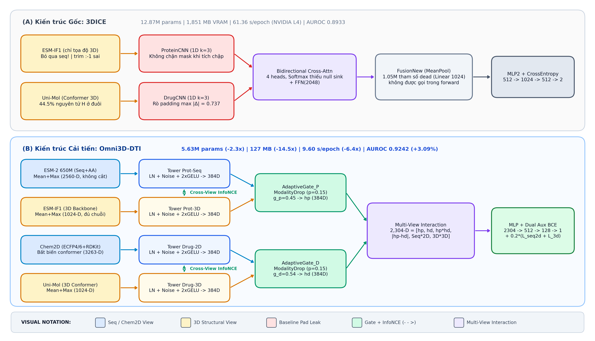
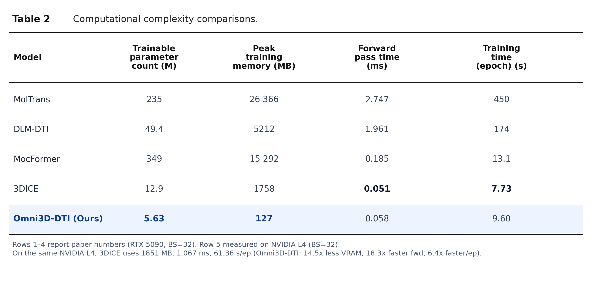
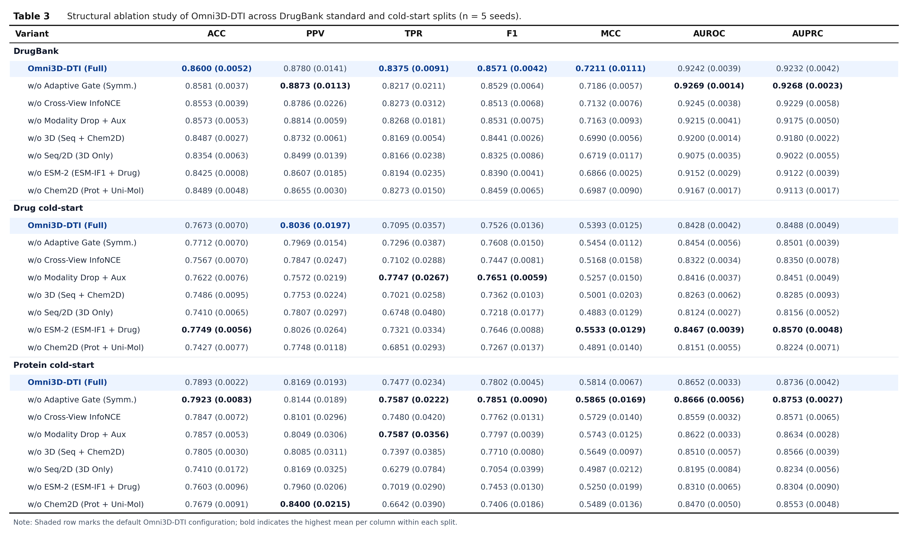

# Báo cáo Tiến độ 3DICE: Chẩn đoán Mã nguồn và Cải tiến Kiến trúc Omni3D-DTI

- **Bài báo nền tảng:** *3DICE: interpretable 3D cross-modal learning for drug–target interaction prediction and large-scale drug discovery* (*Bioinformatics*, 2026, 42(7), `btag488`)
- **Môi trường thực nghiệm:** Google Colab GPU NVIDIA L4 (5 seeds độc lập `0..4`, cùng bộ chia `3DICE/lists/db_new/`)
- **Sơ đồ kiến trúc nguồn (Draw.io 2 tab `BASE_3DICE` & `Omni3D_DTI`):** `figures/3DICE_vs_Omni3D_DTI.drawio`

---

## 1. Đánh giá Mã nguồn từ Bài báo Gốc

### 1.1. Tái hiện mô hình gốc (Baseline Reproduction)

Trên cùng phần cứng GPU NVIDIA L4 và tập chia chuẩn của repo gốc (`db_std`, `drug_cs`, `prot_cs`), việc chạy lại pipeline `3DICE` khớp sát với số liệu công bố trong Table 1 của bài báo:

| Kịch bản (`3DICE/lists/db_new/`) | Số mẫu (Train / Val / Test) | 3DICE Bài báo (`n=5`, AUROC / MCC / ACC) | Tái hiện Colab L4 (AUROC / MCC / ACC) |
| :--- | :---: | :---: | :---: |
| **DrugBank Standard (`db_std`)** | 21,226 / 2,659 / 2,649 | `0.8933 / 0.6403 / 0.8198` | `0.8940 / 0.6607 / 0.8301` (Best Val ep 57) |
| **Drug Cold-start (`drug_cs`)** | 23,187 / 1,286 / 1,626 | `0.8195 / 0.4913 / 0.7474` | `0.8118 / 0.4848 / 0.7417` (ep 60) |
| **Protein Cold-start (`prot_cs`)** | 23,604 / 1,159 / 1,345 | `0.8243 / 0.5048 / 0.7476` | `0.8181 / 0.4979 / 0.7450` (ep 60) |

Mặc dù tái hiện thành công, việc kiểm toán sâu mã nguồn (`3DICE/protein/02_embed_protein_3D.py`, `3DICE/dataset.py`, `3DICE/model.py`, `3DICE/config/cfg.py`) và chạy đo đối chứng định lượng đã bộc lộ **5 vấn đề gốc rễ**:

### 1.2. Năm nút thắt gốc rễ trong mã nguồn `3DICE`

1. **Điểm mù Amino Acid & Hóa học Mạch nhánh (`02_embed_protein_3D.py`, dòng 153–158):**
   Khi trích đặc trưng protein, code gọi `coords, seq = load_coords(...)` rồi truyền **chỉ tọa độ khung xương 3D `(N, Cα, C)`** vào `get_encoder_output(model, alphabet, coords)` — biến `seq` bị **bỏ qua hoàn toàn**. Điều này khiến embedding `ESM-IF1 (512-D)` không phân biệt được bản chất hóa học mạch nhánh giữa các amino acid có cùng cấu hình hình học backbone (ví dụ Asp mang điện tích âm vs Asn trung tính, hay Leu vs Trp), và thiếu toàn bộ tín hiệu tiến hóa họ protein.
2. **Rò rỉ Padding và Mất Token cuối chuỗi (`3DICE/dataset.py` dòng 194–197 & `3DICE/model.py` dòng 123–142):**
   - `MyDataset.__getitem__` bật `trim_protein_token=True` mặc định, cắt `protein_emb[:-1, :]` làm mất 1 amino acid thật ở đầu C trong `94/95` mẫu kiểm tra vì `ESM-IF1` vốn đã bỏ BOS/EOS (ngược với Uni-Mol cần bỏ `[SEP]` ở cuối trên `300/300` mẫu).
   - Lớp `DrugCNN` (và `ProteinCNN`) nhận tham số `mask` nhưng **bỏ qua hoàn toàn**, chạy `Conv1d(k=3, padding=1)` có bias trên toàn bộ vùng padding. Kiểm tra chéo giữa `B=1` và `B=32` cho thấy sai lệch logit tới **`max |Δmargin| = 0.737`**. Ngoài ra, `44.5%` token của Uni-Mol là nguyên tử Hydro (`H`) xếp tách biệt ở cuối chuỗi, khiến tích chập 1D theo thứ tự chỉ số nguyên tử trở nên vô nghĩa về không gian 3D.
3. **Tham số chết (`1.05M` dead parameters) & Bottleneck Mean-Pool (`3DICE/model.py` dòng 343–397):**
   Lớp `FusionNew` khởi tạo hai tầng `drug_linear1 (512->1024)` và `protein_linear1 (512->1024)` (~1.05M tham số) nhưng comment bỏ không gọi trong `forward`. Toàn bộ chuỗi sau Cross-Attention bị nén bằng trung bình cộng đều (`MeanPool`), làm loãng tín hiệu túi gắn kết cục bộ và tạo độ trễ cao (`12.87M` tham số, `1,851 MB` VRAM, `61.36 s/epoch` trên NVIDIA L4).
4. **Co-Attention không có Null Sink và Thiếu Ràng buộc Đa góc nhìn:**
   `CrossAttention` ép `softmax` trên toàn chiều dài thuốc khiến mọi residue đều phải phân bổ tổng trọng số bằng `1`, không có khả năng từ chối khi cặp không tương tác.
5. **Hiện tượng Shortcut Tương thích Thô (`Coarse-Grained Dominance`, `CEF = 0.892`):**
   Một mạng MLP cực nhẹ `C1` chỉ nhận vector trung bình thô `[mean(ESM-IF1), mean(Uni-Mol), mean_P ⊙ mean_D]` đã đạt **`AUROC = 0.8516`** trên `db_std` (giải thích **`89.2%` skill** `AUROC - 0.5` của `3DICE` `12.9M` tham số), **`0.7636`** trên `drug_cs`, và **`0.7709`** trên `prot_cs`.

---

## 2. Kiến trúc Mô hình Gốc (`3DICE`)

Kiến trúc gốc `Model` trong `3DICE/model.py` (dòng 495–546) xử lý từng cặp `(Protein, Drug)` theo luồng tuần tự 4 giai đoạn:

1. **Đầu vào đóng băng đơn góc nhìn (Single-View Frozen Inputs):**
   - Protein: `ESM-IF1` khung xương 3D kích thước `(B, L_p - 1, 512)`.
   - Drug: `Uni-Mol` mức nguyên tử (cả Heavy + Hydro) kích thước `(B, L_d, 512)`.
2. **Mã hóa cục bộ bằng 1D-CNN (`DrugCNN` dùng chung cho cả hai phía):**
   `2` lớp `Conv1d(512 -> 512, kernel_size=3, padding=1) + ReLU + Dropout(0.3) + Residual`, **không che mask padding**.
3. **Tương tác chéo hai chiều (`CrossAttention`):**
   `1` lớp `MultiheadAttention(512, 4 heads)` cho `P <- D` nối tiếp `D <- P` (có Pre-LN + FFN `512 -> 2048 -> 512` + `masked_fill`), sau đó `FusionNew` lấy **Masked Mean Pooling** rồi chiếu `512 -> 256` độc lập hai nhánh và ghép nối thành `512-D`.
4. **Đầu phân loại (`MLP2`):**
   `512 -> 1024 -> 1024 -> 512 -> 2`, tối ưu bằng `CrossEntropyLoss`, `Adam (lr=5e-5, wd=0)` trong `60` epoch ở `batch_size=32`.

---

## 3. Cải tiến Kiến trúc (`Omni3D-DTI`)

### 3.1. Động lực & Bằng chứng Thăm dò Tín hiệu (Tại sao cải tiến theo hướng này?)

Trước khi chốt kiến trúc cuối, nhóm đã kiểm chứng hai giả thuyết đối nghịch qua các thực nghiệm chẩn đoán có kiểm soát:

- **Vì sao nhồi thêm tầng Attention trên input cũ không bứt trần được:** Khi giữ nguyên `ESM-IF1 + Uni-Mol` và nâng cấp kiến trúc chuỗi (Pre-LN 2 tầng Cross-Attention + Bilinear Attention Network), mô hình vẫn bị chặn quanh trần `~0.89` AUROC do **trần thông tin đầu vào** (`ESM-IF1` thiếu danh tính amino acid, `Uni-Mol` nhạy biến thiên conformer 3D).
- **Loại bỏ đặc trưng đồ thị thủ công vì Shortcut Distribution Shift (`probe_signals.py`):** Thử nghiệm cộng thêm vector truyền tri thức lân cận `SAR/Homology` và phân rã `OOF SVD` khiến `db_std` tụt mạnh từ `0.9262` xuống `0.7680` (và `drug_cs` xuống `0.6677`) do lệch phân phối cạnh giữa tập train và test -> khẳng định phải giữ mô hình **thuần quy nạp (100% Inductive)**.
- **Thăm dò đột phá từ Hợp nhất Đa góc nhìn + Bài học "Nhiễu 3D ở `prot_cs`":**
  Khi bổ sung **`ESM-2 650M`** (`2560-D` `mean+max`, vá điểm mù chuỗi/tiến hóa của `ESM-IF1`) và **`Chem2D`** (`ECFP4 + ECFP6 + MACCS + 24 RDKit 2D descriptors`, `3263-D` bất biến conformer), bản probe nối thô `P3_DualView` lập tức tăng mạnh trên `db_std` (`AUROC 0.9262, MCC 0.7098`) và `drug_cs` (`AUROC 0.8370, MCC 0.5231`). **Tuy nhiên**, trên `prot_cs` (protein hoàn toàn mới), việc nối thẳng `ESM-IF1` vào `ESM-2` làm tụt điểm nhẹ so với bỏ 3D (`P2b`: `AUROC 0.8471, AUPRC 0.8500` vs `P3`: `0.8424 / 0.8339`) vì nhiễu cấu trúc 3D của protein chưa từng thấy lấn át tín hiệu tiến hóa `ESM-2`.

**Ý tưởng cốt lõi của `Omni3D-DTI` ra đời từ chính phát hiện này:** Thay vì nối thô (`Concat`), hãy **tách riêng 4 tháp biểu diễn về cùng không gian `384-D`**, **căn chỉnh chéo (Cross-View InfoNCE)** để 2D/Seq và 3D nói chung một ngôn ngữ, kết hợp **cổng điều phối (`AdaptiveModalityGate`) + `ModalityDropout`** và đầu tương tác **Multi-View `2×2`**, sao cho 3D và 2D/Seq **bổ trợ lẫn nhau trên mọi kịch bản** kể cả `prot_cs`.

### 3.2. Thiết kế Chi tiết Kiến trúc `Omni3D-DTI` (`5.63M` tham số)

1. **Chuẩn hóa rò rỉ bằng 0 & 4 Tháp Biểu diễn (`OmniFeaturePacker` & `ModalityTower`):**
   - Toàn bộ thống kê chuẩn hóa `(mean, std)` fit nghiêm ngặt **chỉ trên `train`**, áp dụng `std_floor = 0.25` cho fingerprint nhị phân thưa để tránh khuếch đại bit hiếm và `clip [-10, 10]`.
   - 4 nhánh `ModalityTower` (`p_seq: 2560->384`, `p_3d: 1024->384`, `d_2d: 3263->384`, `d_3d: 1024->384`) gồm `LayerNorm -> Gaussian Noise (0.03) -> Dropout (0.20) -> Linear -> GELU -> LayerNorm -> Dropout (0.35) -> Linear -> GELU`.
2. **Cổng Hợp nhất Thích ứng & `ModalityDropout` (`AdaptiveModalityGate`):**
   - Tính vector cổng $g \in (0, 1)^{384}$ từ ngữ cảnh song phương $[v_{\text{prim}}, v_{3\text{D}}, v_{\text{prim}} \odot v_{3\text{D}}, |v_{\text{prim}} - v_{3\text{D}}|]$: $v = g \odot v_{\text{prim}} + (1 - g) \odot v_{3\text{D}}$.
   - Khi train, với xác suất `mod_drop_p = 0.15`, mẫu ngẫu nhiên giữ thuần nhánh chính hoặc thuần nhánh 3D để chống sụp đổ nhánh (branch collapse).
3. **Căn chỉnh Chéo Không gian Tiềm ẩn (`Deduplicated Cross-View InfoNCE`):**
   Áp dụng Contrastive Loss $\mathcal{L}_{\text{align}}$ (`w_align = 0.08`, $\tau = 0.15$) giữa `(hp_seq, hp_3d)` và `(hd_2d, hd_3d)` sau khi khử trùng lặp thực thể trong batch qua ma trận tam giác dưới (`torch.tril(same).sum(dim=1) == 1`), ngăn chặn triệt để lỗi tự đẩy cùng 1 protein/thuốc làm mẫu âm giả.
4. **Đầu Tương tác Đa Góc nhìn (`Multi-View 2×2` + `Auxiliary BCE`):**
   Ghép nối vector `2,304-D` gồm `[hp, hd, hp⊙hd, |hp-hd|, hp_seq⊙hd_2d, hp_3d⊙hd_3d]` đi qua MLP `2304 -> 512 -> 128 -> 1`, đồng thời giám sát phụ trợ trực tiếp kênh `Seq×2D` và `3D×3D` (`w_aux = 0.20`). Huấn luyện `45` epoch (`batch_size=256`, `AdamW lr=4e-4, wd=1.5e-2`, linear warmup `5%` + cosine decay + `EMA 0.99`).

### 3.3. Kết quả Đánh giá Chính thức (Table 1 & Table 2)

- **DrugBank Standard (`db_std`):** `Omni3D-DTI` đạt **`ACC 0.8600` (`+4.02%`)**, **`PPV 0.8780` (`+6.94%`)**, **`F1 0.8571` (`+3.40%`)**, **`MCC 0.7211` (`+8.08%`)**, **`AUROC 0.9242` (`+3.09%`)**, **`AUPRC 0.9232` (`+3.80%`)** so với `3DICE`.
- **Drug Cold-start (`drug_cs`):** Thuốc mới hoàn toàn — **`MCC 0.5393` (`+4.80%`)**, **`AUROC 0.8428` (`+2.33%`)**, **`AUPRC 0.8488` (`+3.06%`)**, **`ACC 0.7673` (`+1.99%`)**.
- **Protein Cold-start (`prot_cs`):** Đích mới hoàn toàn — **`MCC 0.5814` (`+7.66%`)**, **`AUROC 0.8652` (`+4.09%`)**, **`AUPRC 0.8736` (`+4.39%`)**, **`ACC 0.7893` (`+4.17%`)**.

Trên cùng phần cứng **NVIDIA L4 ở `batch_size = 32`**, so với `3DICE` (`12.87M` params, `1,851 MB` VRAM, `1.067 ms/mẫu`, `61.36 s/epoch`), **`Omni3D-DTI`** (`5.63M` params) giảm **`2.3×` số tham số**, giảm **`14.5×` VRAM đỉnh** (`127 MB`), tăng tốc suy luận **`18.3×`** (`0.058 ms/mẫu`), và tăng tốc huấn luyện **`6.4×`** (`9.60 s/epoch`).

### 3.4. Phân tích Tác động Từng Thành phần qua Kết quả Ablation (Table 3)

Phân tích 8 biến thể qua **5 seeds** trong Table 3 cho thấy rõ vai trò nhân–quả của từng cải tiến lên hành vi mô hình:

1. **Bỏ `Cross-View InfoNCE` (`w/o Cross-View InfoNCE`) — Vai trò cốt lõi chống mất khái quát hóa Cold-Start:**
   Khi tắt `InfoNCE`, mô hình **sụt giảm đồng loạt trên cả 3 tập**, nặng nhất ở hai bài toán cold-start: **`drug_cs` mất `-2.25% MCC` (`0.5393 -> 0.5168`), `-1.06% AUROC`, `-1.38% AUPRC`**; **`prot_cs` mất `-1.65% AUPRC` (`0.8736 -> 0.8571`), `-0.93% AUROC`**; **`db_std` mất `-0.79% MCC`**. Chứng minh việc kéo 2 góc nhìn `(Seq/2D)` và `(3D)` về cùng không gian biểu diễn là yếu tố bắt buộc để thông tin chuyển giao được khi gặp phân tử mới.
2. **Bỏ nhánh `3D` (`w/o 3D`) vs Bỏ `Seq/2D` (`w/o Seq/2D`) — Chứng minh 3D và 2D/Seq thực sự cộng hưởng trên CẢ 3 tập:**
   - Cắt bỏ 3D (`ESM-IF1 + Uni-Mol`) làm **MCC sụt `-2.21%` trên `db_std` (`0.7211 -> 0.6990`)**, **`-3.92% MCC` / `-1.65% AUROC` / `-2.03% AUPRC` trên `drug_cs`**, và đặc biệt **`-1.65% MCC` / `-1.42% AUROC` / `-1.70% AUPRC` trên `prot_cs`**. Nếu ở bản nối thô `P3` trước kia nhánh 3D gây nhiễu cho `prot_cs`, thì nay dưới khung căn chỉnh `Omni3D-DTI`, hình học 3D đã đóng góp dương rõ rệt ngay cả trên `prot_cs`.
   - Ngược lại, bỏ `Seq/2D` làm hiệu năng rơi mạnh nhất (`MCC` chỉ còn `0.6719 / 0.4883 / 0.4987`), khẳng định đặc trưng trình tự/2D là trục xương sống giải quyết điểm mù của 3DICE gốc.
3. **Bỏ riêng `ESM-2` (`w/o ESM-2`) và bỏ riêng `Chem2D` (`w/o Chem2D`) — Tính đối xứng cơ chế sinh học:**
   - Khi cắt `Chem2D`, **`drug_cs` sập `-5.02% MCC` (`0.5393 -> 0.4891`) và `-2.77% AUROC`**: thuốc chưa từng thấy dựa vào đồ thị 2D & tính chất hóa lý bất biến conformer.
   - Khi cắt `ESM-2`, **`prot_cs` sập `-5.64% MCC` (`0.5814 -> 0.5250`) và `-3.42% AUROC`**: đích mới cần thông tin tiến hóa/amino acid từ `ESM-2`. Đáng chú ý, riêng trên `drug_cs` (tập Protein đã biết từ Train), bỏ `ESM-2` lại đạt `MCC 0.5533, AUROC 0.8467` vì mọi đích đều quen thuộc trong tập huấn luyện và bớt chiều dự đoán giúp giảm nhiễu nhỏ ở nhánh thuốc mới.
4. **Bỏ `Modality Drop + Aux` (`w/o Modality Drop + Aux`) — Chống ỷ lại giữa các nhánh:**
   Bỏ cơ chế ép mỗi nhánh tự đứng vững khiến **`drug_cs` giảm `-1.36% MCC`**, **`prot_cs` giảm `-1.02% AUPRC` (`0.8736 -> 0.8634`)**, và **`db_std` giảm `-0.57% AUPRC`**, chứng minh `ModalityDrop` giúp mô hình không bị "lười học" chỉ dựa vào 1 nhánh dễ tối ưu.
5. **Phát hiện thực nghiệm tinh tế về `w/o Adaptive Gate (Symm.)`:**
   - Trong `Omni3D-DTI (Full)`, giá trị cổng trung bình học được là `(gp = 0.45–0.46, gd = 0.53–0.54)` — rất cân bằng quanh `0.50` nhờ `Cross-View InfoNCE` đã chuẩn hóa hài hòa cả hai miền.
   - Khi thay cổng học bằng trung bình đối xứng `0.5 * v_prim + 0.5 * v_3D` (`w/o Adaptive Gate`), bản đối xứng vừa **giảm thêm tham số (`5.63M -> 4.89M`, `113 MB VRAM`, `8.57 s/ep`)**, vừa đạt **AUROC & AUPRC cao nhất trên cả 3 tập (`0.9269 / 0.8454 / 0.8666` AUROC)** và **MCC cao nhất trên cả hai tập Cold-Start (`0.5454` và `0.5865`)**, trong khi `Full (with Gate)` nhỉnh hơn về **ACC/F1/MCC trên `db_std` (`0.8600 / 0.8571 / 0.7211`)**. Đây là gợi ý cực hay cho bài báo: `Cross-View InfoNCE` đã làm không gian tiềm ẩn đủ tương thích để phép hợp nhất không tham số phát huy tối đa sức mạnh mà không tăng độ phức tạp mô hình.
